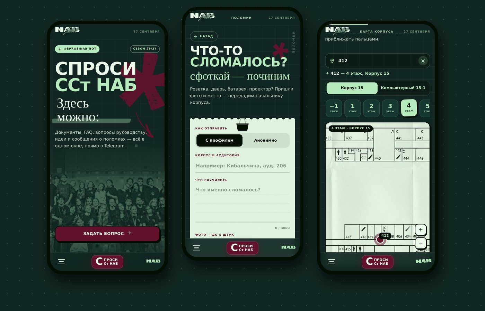
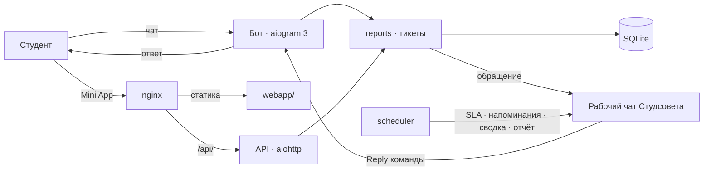

<div align="center">

# Спроси ССт НАБ

**Telegram-бот и Mini App Студенческого совета факультета «Налоги, аудит и бизнес-анализ» Финансового университета**

[](https://github.com/antonshkelll/nab-bot/actions/workflows/tests.yml)


[**Открыть бота**](https://t.me/sprosinab_bot) · [Mini App (код)](https://github.com/antonshkelll/nab-app) · [Установка на сервер](INSTRUCTION.md) · [Что нового](CHANGELOG.md)



</div>

Студент задаёт вопрос руководству, предлагает идею или сообщает о поломке в корпусе — и видит, что с обращением происходит дальше:
его взяли в работу, ответили, решили. Команда Студсовета отвечает прямо в рабочем чате, а бот следит, чтобы ни одно обращение не зависло.
Документы вуза, FAQ, карта корпуса, анонсы и опросы — в том же боте и в Mini App.

## Что нового в версии 3

| | Было (v2) | Стало (v3) |
|---|---|---|
| Обращения | сообщение в рабочий чат | тикет со статусом, перепиской и оценкой ответа |
| Анонимность | ID в подписи сообщения | связь с автором зашифрована ключом сервера, в базе её нет |
| Контроль | — | SLA: напоминание о просроченных обращениях |
| Контент | FAQ, НПБ, карта | + анонсы с записью и напоминаниями, опросы, новости |
| Админка | команда `/send` | админ-панель в Mini App: обращения, рассылки, анонсы, опросы |
| Отчётность | `nab stats` в терминале | сводка раз в неделю и отчёт за месяц в Excel |
| Установка | 10 ручных команд | `install.sh` и команда `nab` |

Подробно — в [CHANGELOG.md](CHANGELOG.md).

## Возможности

| Раздел | Бот | Mini App |
|---|:--:|:--:|
| ❓ Вопросы руководству, 💡 инициативы, 🛠 поломки (до 5 фото), 🚨 тревожная кнопка | ✅ | ✅ |
| 🗂 Мои обращения: статус, переписка, оценка ответа | ✅ | ✅ |
| Анонимная отправка | ✅ | ✅ |
| 📅 Анонсы: запись «пойду», напоминания | ✅ | ✅ |
| 📊 Опросы и новости | ✅ | ✅ |
| 📚 НПБ (9 документов) и 📖 FAQ на 27 страниц с поиском | ✅ | ✅ |
| 🗺 Карта корпуса с поиском аудитории | ✅ | ✅ |
| 📌 Группы и 📞 контакты | ✅ | ✅ |
| 🛡 Админка: обращения, рассылки, анонсы, опросы, дашборд, выгрузка в Excel | — | ✅ |

## Как устроено



Бот и API работают в одном процессе и используют общие модули, поэтому обращение из чата и из Mini App выглядит одинаково.

| Модуль | Что делает |
|---|---|
| `main.py` | бот: меню, формы, ответы команды, рассылки |
| `api.py` · `webapi.py` | обработчики Mini App и их подключение к aiohttp |
| `reports.py` | обращения: создание, статусы, переписка, анонимность, оценки, SLA, сводка |
| `content.py` | новости, анонсы с записью, опросы, ссылки и контакты |
| `stats.py` · `xlsx.py` | дашборд метрик и отчёт за месяц в Excel без сторонних библиотек |
| `scheduler.py` | фоновые задачи: напоминания, просрочки, сводка, отчёт |
| `store.py` | SQLite, настройки, анонимная статистика |
| `security.py` | проверка подписи Telegram `initData` |
| `delivery.py` · `tgutil.py` · `keyboards.py` | формат сообщений, безопасная отправка, клавиатуры |

## Метрики без слежки

Студсовету важно понимать, какие разделы нужны студентам и как быстро команда отвечает, но не следить за людьми.

- **Счётчики событий по дням:** открытия экранов, нажатия, поиски (в том числе пустые), платформы, кнопки бота — без привязки к пользователю.
- **Уникальные посетители за день, неделю и месяц** хранятся как HMAC-хеш с солью периода: по нему нельзя узнать человека и нельзя связать разные периоды.
- **Обращения:** число по типам и статусам, доля анонимных и отправленных из Mini App, среднее время до взятия в работу и до решения, средняя оценка ответа и последние отзывы.
- **Анонсы и опросы:** записи «пойду / не пойду», голоса.

Дашборд открывается в админке Mini App, а первого числа каждого месяца команда получает отчёт в Excel.

## Безопасность

- Каждый запрос Mini App несёт подписанный Telegram `initData`; `security.py` проверяет HMAC-SHA256 и срок жизни — подделать отправителя нельзя.
- Анонимность: связь «обращение → автор» зашифрована ключом из `.env` (`SECRET_KEY`); копия базы без `.env` авторов не раскрывает.
- Ограничения частоты и размера запросов, защита от флуда в переписке.
- Токен, ID администраторов и чатов — только в `.env`, в коде их нет.

## Установка

Сервер с Ubuntu — одна команда, подробности в [INSTRUCTION.md](INSTRUCTION.md):

```bash
bash install.sh
```

Обслуживание: `nab status` · `nab restart` · `nab log` · `nab doctor` · `nab update` · `nab publish` · `nab docs` · `nab clean`.

Локально:

```bash
git clone https://github.com/antonshkelll/nab-bot.git && cd nab-bot
git clone https://github.com/antonshkelll/nab-app.git webapp
python3 -m venv venv && ./venv/bin/pip install -r requirements.txt
cp .env.example .env        # BOT_TOKEN, ADMIN_IDS, SUPER_CHAT_ID
./venv/bin/python main.py
```

## Тесты

Тесты работают с поддельным Telegram — без токена и без интернета. В CI они запускаются на каждый push.

```bash
python3 tests/test_security.py   # подпись initData — 12 проверок
python3 tests/test_core.py       # обращения, анонимность, анонсы, опросы, API — 113 проверок
python3 tests/test_bot.py        # запуск, профиль бота, команды — 39 проверок
node tests/e2e.js                # интерфейс Mini App (Playwright)
```

## Стек

Python 3.10+ · aiogram 3 · aiohttp · SQLite · pypdf · nginx · systemd · Telegram Mini App (HTML, CSS, JS без сборки)

## Автор

Антон Шкель, ПрИнж25-1, Финансовый университет при Правительстве РФ.

Код — под лицензией [MIT](LICENSE). Логотипы NAB Label, фотографии, шрифты и документы принадлежат Студенческому совету НАБ и под лицензию не входят.
