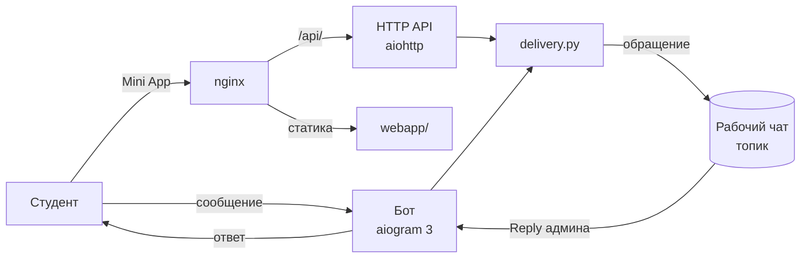

# Спроси ССт НАБ — Telegram-бот

Официальный бот-помощник Студенческого совета факультета «Налоги, аудит и бизнес-анализ»
Финансового университета: [@sprosinab_bot](https://t.me/sprosinab_bot).

Студент задаёт вопрос руководству, предлагает идею или сообщает о поломке в корпусе, а
сообщение приходит в рабочий чат Студсовета. Админ отвечает обычным Reply, и ответ уходит
студенту от имени бота. Документы вуза, FAQ и карта корпуса открываются в этом же чате.

К боту подключено веб-приложение (Telegram Mini App) — **[nab-app](https://github.com/antonshkelll/nab-app)**.


## Что умеет

| Раздел | |
|---|---|
| ❓ Вопросы руководству | можно анонимно; ответ приходит в чат с ботом |
| 💡 Инициативы | идеи студентов сразу в рабочий чат |
| 🛠 Поломки | до 5 фото + место (корпус, аудитория) → начальнику корпуса |
| 🚨 Тревожная кнопка | срочные обращения помечаются отдельно |
| 📚 НПБ | 9 документов вуза в PDF |
| 📖 FAQ | 27 страниц, в Mini App — листалка с поиском и живыми ссылками |
| 🗺 Карта корпуса | все этажи, поиск аудитории по номеру |
| 📌 Группы и 📞 контакты | каналы факультета и руководство ССт |
| 📣 `/send` | рассылка всем пользователям (только для админов) |

## Как устроено



Бот и API работают в одном процессе и используют общую доставку сообщений (`delivery.py`),
поэтому обращение из чата и из приложения выглядит в рабочем чате одинаково.

- **Проверка подписи Mini App.** Каждый запрос к API несёт `initData` от Telegram.
  `security.py` проверяет его HMAC-SHA256 подпись токеном бота и срок жизни — подделать
  отправителя нельзя.
- **Антиспам в API.** Не чаще одного обращения в 20 секунд от человека, лимит размера и числа фото.
- **Ответы через Reply.** В подписи каждого обращения спрятан ID отправителя, поэтому бот
  знает, кому переслать ответ админа. База — SQLite (только ID пользователей для рассылки).
- **Секреты только в `.env`.** Токен, ID админов и чата в коде не хранятся.

## Аналитика

Бот пишет события в `analytics.db`: нажатия разделов, команды, отправленные обращения и доставленные ответы админов. Считаются только личные чаты со студентами, рабочий чат Студсовета в метрики не попадает. Вместо Telegram ID хранится HMAC-хеш, а из текста сохраняются только названия кнопок меню, так что вопросы студентов в базу не попадают. Отключается строкой `ANALYTICS=0` в `.env`.

```bash
nab stats        # или: ./venv/bin/python tools/stats.py 30
```

```
Пользователи: DAU · WAU · MAU · stickiness
Обращения за 30 дней по типам
Популярные разделы (уникальные пользователи)
Воронка «Поломки»: открыли → отправили
Ответ Студсовета: медиана часов до ответа
Retention 2-й недели
```

По этим цифрам видно, какие разделы реально нужны студентам, где бросают форму поломки и как быстро Студсовет отвечает.

## Стек

Python 3.10+ · aiogram 3 · aiohttp · SQLite · pypdf / pdfplumber · nginx · systemd

## Структура

```
main.py          бот: меню, разделы, формы, ответы админов, рассылка
webapi.py        HTTP API для Mini App: /api/report, /api/doc, /api/faq
delivery.py      единый формат обращений в рабочий чат
security.py      проверка подписи Telegram initData
analytics.py     событийная аналитика: middleware, track(), отчёт
config.py        настройки (значения берутся из .env)
tools/
  build_faq.sh   PDF → страницы webp + ссылки + текст для поиска
  build_docs.py  то же для документов НПБ
  build_map.py   карта корпуса + распознавание номеров аудиторий (tesseract)
                 зависимости инструментов — requirements-tools.txt
  pdf_links.py   ссылки из PDF → кликабельные зоны поверх страниц
  nab.sh         управление ботом на сервере одной командой
  doctor.sh      диагностика сервера
  stats.py       отчёт по метрикам из analytics.db
deploy/          systemd-сервис и конфиг nginx
tests/           тесты без интернета и без aiogram
```

## Запуск локально

```bash
git clone https://github.com/antonshkelll/nab-bot.git
cd nab-bot
python3 -m venv venv
./venv/bin/pip install -r requirements.txt
cp .env.example .env        # впишите BOT_TOKEN, ADMIN_IDS, SUPER_CHAT_ID
./venv/bin/python main.py
```

## Развёртывание на сервере

```bash
sudo git clone https://github.com/antonshkelll/nab-bot.git /opt/sprosinab
sudo git clone https://github.com/antonshkelll/nab-app.git /opt/sprosinab/webapp
cd /opt/sprosinab
python3 -m venv venv && ./venv/bin/pip install -r requirements.txt
cp .env.example .env && nano .env

sudo cp deploy/sprosinab.service /etc/systemd/system/
sudo cp deploy/nginx.conf /etc/nginx/sites-enabled/sprosinab.conf   # поменяйте домен
sudo certbot --nginx -d nab.example.ru
bash tools/publish_webapp.sh
sudo systemctl enable --now sprosinab
```

Дальше всё делается через `nab`: `nab status`, `nab log`, `nab faq`, `nab map`, `nab doctor`, `nab stats`.

## Тесты

```bash
python3 tests/test_security.py   # подпись initData
python3 tests/test_delivery.py   # формат обращений и доставка
python3 tests/test_bot.py        # /start и запуск бота на заглушках
python3 tests/test_analytics.py  # события, приватность, отчёт
```

## Автор

Антон Шкель, ПрИнж25-1, Финансовый университет при Правительстве РФ.

Код — под лицензией [MIT](LICENSE). Логотипы NAB Label, фотографии и документы принадлежат
Студенческому совету НАБ и под лицензию не входят.
